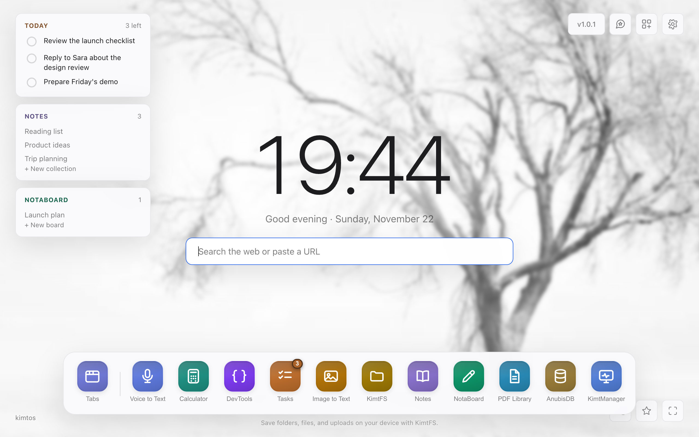

<h1 align="center">Kimtos</h1>

<p align="center">
  <strong>A private, local-first workspace in every new browser tab.</strong><br>
  Notes, tasks, PDFs, whiteboards, recordings and on-device AI. Free, open source, no account.
</p>

<p align="center">
  <a href="LICENSE"></a>
  <a href="https://github.com/MoonLandingLabs/kimtos-core/actions/workflows/test.yml"></a>
  <a href="https://github.com/MoonLandingLabs/kimtos-core/actions/workflows/extension.yml"></a>
  <a href="https://github.com/MoonLandingLabs/kimtos-core/releases"></a>
  <a href="CONTRIBUTING.md"></a>
</p>

<p align="center">
  
</p>

Kimtos turns every new tab into a workspace: a **Chrome new-tab (Manifest V3) extension** with a
dock of daily tools over a rotating wallpaper. Your notes, tasks, PDFs, clipboard and recordings
live in your browser (IndexedDB), and the AI tools (chat, voice to text, image to text, grammar)
run **on-device** with WebAssembly and WebGPU, so your content never leaves your machine.

## Why Kimtos

- **Private by design.** No account, no sign-in, no server, no telemetry. Kimtos collects no data at all.
- **Local-first.** Everything is stored in your browser and works offline once a model is downloaded.
- **On-device AI.** Models run in your browser. They are downloaded once from Hugging Face, a public host.
- **Free, with no catch.** No plan, trial, paywall or payment of any kind. MIT licensed.
- **Small, composable apps.** Each tool is a self-contained app that follows the same conventions.

## Apps

| Area           | Apps                                                              |
| -------------- | ----------------------------------------------------------------- |
| Write and plan | Notes, Tasks, NotaBoard (whiteboard), Calculator, Tabs            |
| Documents      | PDF Library, Retouch, Image to Text                               |
| Audio / video  | Voice to Text, Voice Studio, Denoise, Video Recorder              |
| Writing aids   | Grammit (grammar and spelling), Rewordit, KimtAI (on-device chat) |
| Developer      | DevTools, FakeForm, AnubisDB (data console), KimtFS, Clipboard    |

## Install

**From the Chrome Web Store:**
[Kimtos](https://chromewebstore.google.com/detail/kimtos/cmjagcogohpnfkladbfhgijofbcmedip).

**From source** (Node and npm versions are pinned in `.nvmrc` and `package.json`; see
[CONTRIBUTING.md](CONTRIBUTING.md)):

```bash
git clone https://github.com/MoonLandingLabs/kimtos-core
cd kimtos-core
make install     # install all workspaces
make build       # build the extension -> extension/dist
```

Then open `chrome://extensions`, enable **Developer mode**, choose **Load unpacked** and select
`extension/dist`. No account, API key or server is needed.

## Development

```bash
make dev         # extension Vite dev server (http://localhost:5173)
make www         # Nuxt static marketing site (http://localhost:8799)
make docs        # docs site dev server
make help        # every target
```

## Privacy

Kimtos has no backend. The only network requests are the ones you can see: model files from
Hugging Face (once, when you install a model), and a few optional cards that call public APIs
you switch on yourself (weather, developer news). The full list of hosts is in
[`scripts/network-hosts.mjs`](scripts/network-hosts.mjs) and is checked in CI.

## Contributing

Bug reports, ideas and pull requests are welcome. Start with [CONTRIBUTING.md](CONTRIBUTING.md),
follow the [Code of Conduct](CODE_OF_CONDUCT.md), and report security problems as described in
[SECURITY.md](SECURITY.md). Questions and bugs go to the
[issue tracker](https://github.com/MoonLandingLabs/kimtos-core/issues). There is no support desk
or chat.

## Repo layout

A single npm-workspaces monorepo:

| Workspace          | What it is                                                                       |
| ------------------ | -------------------------------------------------------------------------------- |
| `extension/`       | `@kimtos/extension` — the MV3 new-tab extension (Vite + TypeScript)              |
| `www/`             | `@kimtos/www` — the static marketing site (Nuxt 4, `nuxt generate`)              |
| `www-docs/`        | `@kimtos/www-docs` — the static docs site (VitePress)                            |
| `shared-modules/*` | shared packages — `@kimtos/config`, `@kimtos/icons`, `@kimtos/prompts`, and more |

## Documentation

| Topic                     | Where                                                                    |
| ------------------------- | ------------------------------------------------------------------------ |
| Full documentation        | [`docs/`](docs/)                                                         |
| Architecture & data layer | [`docs/extension/architecture.md`](docs/extension/architecture.md)       |
| Creating an app           | [`docs/extension/creating-an-app.md`](docs/extension/creating-an-app.md) |
| Releasing                 | [`docs/extension/releasing.md`](docs/extension/releasing.md)             |
| App conventions           | [`CLAUDE.md`](CLAUDE.md)                                                 |

## License

Kimtos is released under the [MIT License](LICENSE).

Kimtos is built on open-source components, which remain under their own licences;
their notices are reproduced in
[THIRD-PARTY-NOTICES.md](THIRD-PARTY-NOTICES.md).

© 2026 Mahmoud Emad
