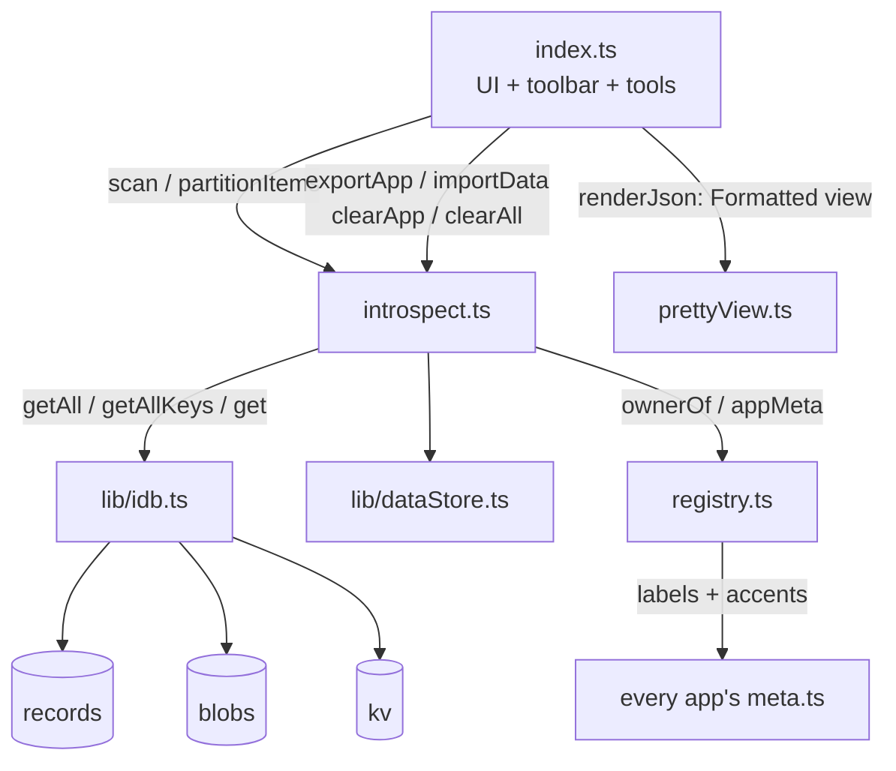

# Architecture

AnubisDB is the DB inspector, not a per-collection CRUD app: it reads the
one shared `kimtos` IndexedDB directly, groups every partition under the app that
owns it, and offers per-app and global export, import, and clear. Everything is
local. The code lives in `extension/src/apps/anubisdb/`.

## Modules

| File                              | Role                                                                                                                                                                                                                                               |
| --------------------------------- | -------------------------------------------------------------------------------------------------------------------------------------------------------------------------------------------------------------------------------------------------- |
| `meta.ts`                         | The app manifest — id, name, accent (`#c9a34a`), order, and App Store marketing copy.                                                                                                                                                              |
| `index.ts`                        | The app descriptor and UI — the toolbar totals, the app list, the detail pane with expandable partitions and rows, downloads, and the export/import/clear actions (each with a confirm and Undo). Also declares the read-only KimtAI tools.        |
| `introspect.ts`                   | The read/export/import/clear layer over the database. `scan()` walks the three stores and builds the grouped snapshot; `partitionItems()` loads one partition's items; `exportApp`/`importData`/`clearApp`/`clearAll` handle backups and deletion. |
| `registry.ts`                     | Ownership resolution. `ownerOf(name)` maps a records collection, blob namespace, or kv key to the owning app id; app labels/colours are derived from every app's `meta.ts`, plus system buckets and an "Unmapped data" fallback.                   |
| `prettyView.ts`                   | The human-readable record inspector. `renderJson()` / `renderValue()` turn stored JSON into a readable field view — typed values, smart timestamps, links, image thumbnails, and collapsible nesting — behind the "Formatted view" default.        |
| `lib/idb.ts` · `lib/dataStore.ts` | The shared low-level IndexedDB access and the suite's data-store helpers used for reads, blob/kv deletes, and full-backup export/import.                                                                                                           |

## How it reads the store

`scan()` reads all `records`, plus the keys of `blobs` and `kv`, from the single
`kimtos` database. Each row is grouped into a **bucket** keyed by kind and
partition; `ownerOf` resolves which app the partition belongs to, and the buckets
are folded into per-app **nodes** carrying counts and sizes. Records are measured
by their JSON byte length; a blob is measured by its cheap `.size` (its bytes are
never loaded to do so). Apps are sorted with system and unmapped owners last.

## Resolving ownership

`registry.ts` derives ownership from the storage naming convention rather than a
hand-maintained table:

- **`history:<app>`** keys (and `history:<app>/<uid>` blobs) map straight to that
  app.
- A small **legacy** table covers a few early collections and prefixes whose
  names predate the convention (e.g. `todos` → tasks, `pdf:` → pdflib).
- Otherwise the **leading segment** (before `-`, `:`, or `/`) is taken as the
  owning app id — `thoth-chunks` and `thoth:hashes` both resolve to `thoth`. If
  that id is a known app, it wins.
- Anything still unresolved is grouped under **Unmapped data**; unprefixed kv
  keys default to the **system** bucket.

Because labels and accents come from each app's own `meta.ts`, a new app's data
is named, coloured, and grouped automatically — no edit to AnubisDB.

## Export, import, and clear

- **Export** builds a self-contained per-app dump (`format: 'anubisdb-app'`) with
  records copied verbatim, blobs inlined as data URLs, and kv values included.
  **Export all** delegates to the data store's full-backup export
  (`kimtos-data`).
- **Import** accepts either format: a full backup is restored through the data
  store; a per-app dump is written back with `idb.put` for each record, blob
  (data URL → Blob), and kv value. Any other file is rejected.
- **Clear** first captures a backup (via the same export path) for undo, then
  deletes the app's records, blobs, and kv entries; **Clear all** captures a full
  backup and empties all three stores. The captured backup is what the Undo toast
  passes straight back to import.

## Auto-refresh

The UI subscribes to the data store's change signal (debounced ~400 ms to
collapse bursts like a bulk clear) and to tab focus/visibility, then re-scans. A
lightweight **fingerprint** of the snapshot (per-app and per-partition counts and
sizes) is compared before redrawing, so the DOM is rebuilt only when something
material changed — preserving selection and scroll and avoiding flicker.
