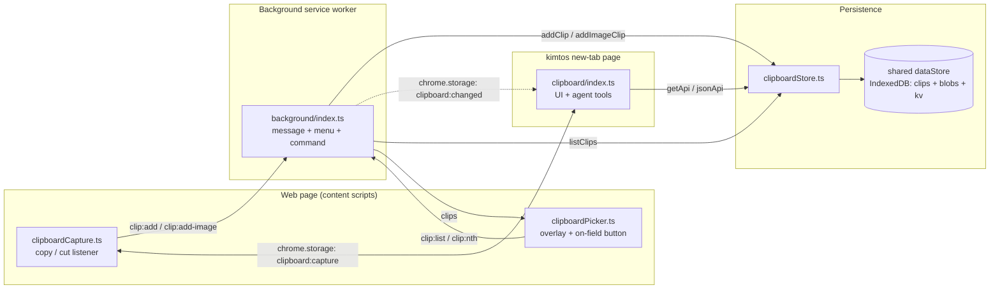

# Architecture

Clipboard spans **three browser contexts** that a normal app does not: the
new-tab page (the UI + agent tools), a background **service worker** (added to the
extension specifically for this app), and two **content scripts** that run on
every page. Those content scripts are not declared in the manifest; the service
worker registers them at runtime (`chrome.scripting`) once the app is installed
and the user has granted the optional all-sites permission, and unregisters them
otherwise — so the base install requests no page access (#637). A content script
cannot reach the extension's IndexedDB, so all persistence happens in the service
worker; the contexts coordinate through message passing and `chrome.storage.local`.

## Modules

| File                                | Role                                                                                                                                                                                                                                                                                                                                                                        |
| ----------------------------------- | --------------------------------------------------------------------------------------------------------------------------------------------------------------------------------------------------------------------------------------------------------------------------------------------------------------------------------------------------------------------------- |
| `apps/clipboard/index.ts`           | The app descriptor and browse/search/manage UI: toolbar, filter chips, the clip list (star/copy/edit/tag/delete), batch-select + merge, the settings drawer, and the stats/export/import/clear footer. Also declares the KimtAI agent tools. All data ops go through the local API (`getApi`/`jsonApi`).                                                                    |
| `apps/clipboard/meta.ts`            | App metadata — id, accent, order, `optIn: true`, and marketing copy.                                                                                                                                                                                                                                                                                                        |
| `apps/clipboard/clipboard.local.ts` | The app's `clipboard.local` routes — read/search/manage operations over `clipboardStore`, registered on the local API router (`getApi`/`jsonApi`), so the in-page UI and the service worker share one data path.                                                                                                                                                            |
| `lib/clipboardShared.ts`            | DOM-free, storage-free primitives shared by all three contexts: the `ClipItem`/`CaptureState` types, collection/key constants, the FNV-1a `hashText`, `classifyText`, `previewOf`, the cross-context capture-state accessors (`get/setCaptureState`), change signals, and the installed gate.                                                                               |
| `lib/clipboardStore.ts`             | The persistence layer over the shared `dataStore` (IndexedDB): add/patch/remove clips and image clips, hash-based dedupe, `trim` to `maxItems` (never evicting favorites), merge, stats, tags, and JSON import/export. Used by both the service worker and the app's local routes so behavior is identical everywhere. The capture content script must **not** import this. |
| `background/index.ts`               | The MV3 service worker: receives captured copies from content scripts and persists them via `clipboardStore`, serves history to the in-page picker, and owns the context-menu items and the paste-history hotkey.                                                                                                                                                           |
| `content/clipboardCapture.ts`       | Capture content script (every https page). Listens for `copy`/`cut`, honors monitor/pause/exclusions and the password-field rule, and forwards the copied text (or opt-in image) to the service worker. Stores nothing itself.                                                                                                                                              |
| `content/clipboardPicker.ts`        | The in-page history picker (shadow-DOM search overlay), the `Alt+Shift+V` / quick-paste key handling, and the on-field floating paste button. Fetches history from the service worker and inserts the chosen clip into the focused field.                                                                                                                                   |

The UI never touches storage directly: it calls `getApi` / `jsonApi` (the suite's
local router, dispatched to the app's `clipboard.local` routes), the same path
the agent tools use — so UI and tools stay in sync.

## Capture → store → paste flow

## Cross-context coordination

- **Capture settings** (`CaptureState`) live in `chrome.storage.local` under
  `clipboard:capture`. The UI edits them; the content script and worker read them.
  The content script keeps a synchronous local copy and live-reloads it when the
  key changes (`onCaptureChanged`), starting from monitor-on defaults so no copy
  is dropped while the async read is in flight.
- **Change signal** — the worker cannot reach the page's `dataStore` listeners,
  so after a capture it bumps `clipboard:changed` in `chrome.storage.local`; open
  app windows listen (`onClipsChanged`) and reload. The UI also refreshes on its
  own edits (`dataStore.onChange`) and on window focus.
- **Install gate** — because the capture content script is always injected,
  it checks a cached "installed" flag (`clipboardActiveCached`) before doing
  anything; the worker re-checks `clipboardActive()` before storing. A user
  who has not installed the app never has their clipboard captured.

## Messages, menus, and commands

The worker's `chrome.runtime.onMessage` handles `clip:add`, `clip:add-image`,
`clip:list` (up to 200 recent, for the picker), and `clip:nth` (quick-paste). It
registers three **context-menu** items (save selection, open picker, open side
panel) via the `contextMenus` permission, opens the picker in the active tab on
the `open-clipboard-picker` **command** (`Alt+Shift+V`), and opens Chrome's side
panel on request.

## Data model

One record type, `ClipItem`, in the `clipboard-items` collection:

- `{ id, type, text, preview, hash, bytes, favorite, tags, createdAt,
lastUsedAt, useCount, source?, mime? }`.
- `type` is `text` | `link` | `color` | `image`, assigned by `classifyText`.
- `preview` is a single-line, 200-char-capped display string.
- `hash` is a fast FNV-1a hash used **only** for dedupe — a hash hit is confirmed
  by an exact text compare, so a collision can never merge two different clips.
- `source` records the originating page's `{ url, title, favicon }`.
- Image clips carry a `mime` and store their bytes in the blob store at
  `clipboard:<id>` (the record's `text` is empty).

Tags are stored separately as `{ name, color }` in the key/value store under
`clipboard:tags`, auto-assigned the next color from a fixed palette; items
reference tags by name.
