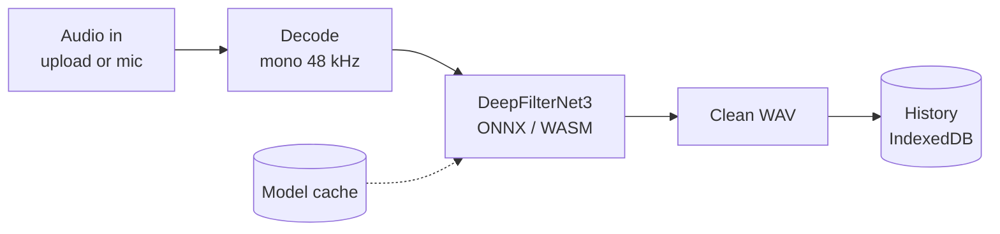

# Architecture

Denoise follows the suite convention: a small UI descriptor plus a self-contained
**model engine**, with all clips stored on-device. The heavy lifting — running
the model — happens entirely in the browser via WebAssembly. The app code lives
in `extension/src/apps/denoise/`.

## Modules

| File                           | Role                                                                                                                                         |
| ------------------------------ | -------------------------------------------------------------------------------------------------------------------------------------------- |
| `apps/denoise/index.ts`        | The app descriptor and UI — input screen, progress, the A/B result player, the history sidebar, downloads, and Voice to Text hand-off.       |
| `lib/engines/denoise.ts`       | The model engine — fetches/caches the ONNX model, decodes audio, runs DeepFilterNet3 on onnxruntime-web (WASM), and encodes the cleaned WAV. |
| `components/audioInput.ts`     | Reusable upload / record input with a live timer and clip preview.                                                                           |
| `components/audioPlayer.ts`    | The compact audio player used for the Cleaned and Original tracks.                                                                           |
| `components/historySidebar.ts` | The titled history list — open, right-click menu, multi-select, and delete with undo.                                                        |
| `components/progressBar.ts`    | The download / processing progress bar.                                                                                                      |
| `lib/dataStore.ts`             | On-device storage — records and binary blobs in IndexedDB.                                                                                   |
| `lib/appHandoff.ts`            | The in-memory baton for passing a clip to another app (e.g. Voice to Text).                                                                  |

## Pipeline

The UI never runs the model itself: it calls `denoiseAudio(blob)` in
`engines/denoise.ts`, which owns the whole audio path. The result is saved
through the shared data store and shown in the sidebar.

## How the engine works

`engines/denoise.ts` carries the model I/O contract end to end:

- **Model fetch & cache** — the ONNX file is requested from Cache Storage first;
  on a miss it downloads once (with byte progress) from Hugging Face
  (`kimtos-labs/denoiser-dfn3`, via `DENOISER_URL` in `lib/modelHosts.ts`) and is cached under
  `kimtos-models`, so later runs are instant and **offline**.
- **Session** — onnxruntime-web is loaded and run **single-threaded** with the
  WASM execution provider. In production the `.wasm` is self-hosted (the
  extension's CSP blocks CDNs).
- **Decode** — any browser-supported audio is decoded to **mono 48 kHz** Float32
  via an `AudioContext` (which resamples and down-mixes for us).
- **Inference** — the model is an end-to-end graph (PCM in → clean PCM out, with
  all the STFT / ERB / deep-filter DSP baked in). It runs **frame by frame** in
  10 ms hops (480 samples), carrying a recurrent **state** vector between frames.
  Progress is reported periodically.
- **Encode** — the cleaned samples are written to a minimal 16-bit PCM **WAV**
  blob.

DeepFilterNet3 (MIT / Apache-2.0) is exported to a single ONNX graph via torchDF.

## Storage

History lives under the `history:denoise` collection. Each run saves:

- the **original** clip and the **cleaned** WAV as separate blobs, and
- a record with `{ name, at, origKey, cleanKey, from, srcId }`.

`from` and `srcId` track a clip's provenance — so a clip that came from Voice to
Text isn't offered straight back, and re-runs of the same source can be detected.
History is capped at the most recent **30** clips; older runs (and their blobs)
are pruned automatically. Deleting a clip removes its record and both blobs, and
the app's **Clear data** wipes the whole collection and its blobs.
