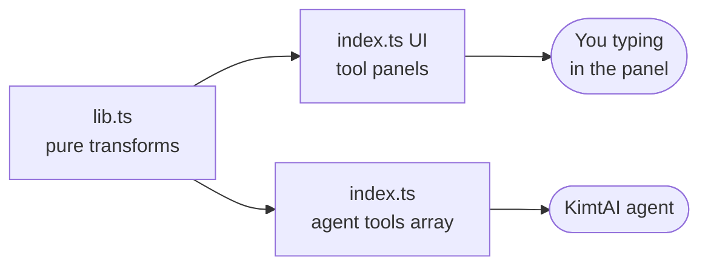

# Architecture

DevTools is deliberately simple: a set of **pure transforms** with a thin UI on
top. The transforms have no side effects, touch no storage, and make no network
calls — which is what lets the exact same functions power both the on-screen
tools and the agent tools. The code lives in `extension/src/apps/devtools/`.

## Modules

| File           | Role                                                                                                                                                                                                                                                                                                                                         |
| -------------- | -------------------------------------------------------------------------------------------------------------------------------------------------------------------------------------------------------------------------------------------------------------------------------------------------------------------------------------------- |
| `lib.ts`       | The pure transforms — `formatJson` / `minifyJson`, `encodeBase64` / `decodeBase64`, `encodeUri` / `encodeUrl` / `decodeUrl`, `encodeHtml` / `decodeHtml`, `decodeJwt`, `hashText`, `uuidV4`, `toCase`, `parseColor`, `epochToDate` / `dateToEpoch`, `convertBase`, and `lorem`. Each throws an `Error` with a friendly message on bad input. |
| `index.ts`     | The app descriptor and UI — the tool registry and left-rail grouping, the shared Input → Output panel, the live tools (hash, case, color, timestamp, number base, regex, diff), and the agent `tools` array.                                                                                                                                 |
| `meta.ts`      | The app manifest (id, name, accent, order, marketing copy) consumed by the dock, App Store, and this docs build.                                                                                                                                                                                                                             |
| `devtools.css` | Styling for the sidebar, tool panels, rows, and match highlighting.                                                                                                                                                                                                                                                                          |

## The transforms-and-tools split

The interesting property is that `lib.ts` is the single source of truth, used two
ways:

- The **UI** wires each transform to a panel — buttons for the Input → Output
  tools, live `input` listeners for the rest — and renders errors inline.
- The **agent tools** wrap the same transforms, declared for a future on-device
  assistant (they are dormant — no shipped model can call them). Each is guarded so
  it returns `{ ok, result, summary }` instead of throwing.

Because both paths call the identical functions, the tools and the UI can never
drift apart.

## Agent tools

DevTools declares a subset of its transforms as MCP-shaped tools for a future
KimtAI agent (they are dormant — no shipped model can call them; per the suite
convention). They are all pure and stateless, so there is no list/get/CRUD
surface — just transforms:

| Tool                              | Wraps                                                                      |
| --------------------------------- | -------------------------------------------------------------------------- |
| `format_json`                     | `formatJson` — pretty-print / validate JSON.                               |
| `decode_jwt`                      | `decodeJwt` — header + payload, no signature check.                        |
| `base64_encode` / `base64_decode` | `encodeBase64` / `decodeBase64`.                                           |
| `hash_text`                       | `hashText` — SHA-1 / SHA-256 / SHA-384 / SHA-512 (defaults to SHA-256).    |
| `uuid`                            | `uuidV4` — one or more random v4 UUIDs.                                    |
| `convert_case`                    | `toCase` — camel, pascal, snake, kebab, constant, title, sentence, or dot. |
| `convert_color`                   | `parseColor` — hex / rgb / hsl to all three formats.                       |

The remaining UI-only tools (URL and HTML entity coding, lorem ipsum, timestamp
and number-base conversion, the regex tester, and the text diff) are interactive
by nature and are not exposed as agent tools.

## No persistence

There is nothing to persist. DevTools writes no records, blobs, or key/value
entries to the suite's shared database, keeps no settings, and holds no in-memory
history — every tool starts blank each time you open it. This is why the app
carries no privacy surface beyond the transforms themselves: the data only ever
lives in the input and output fields on screen.
