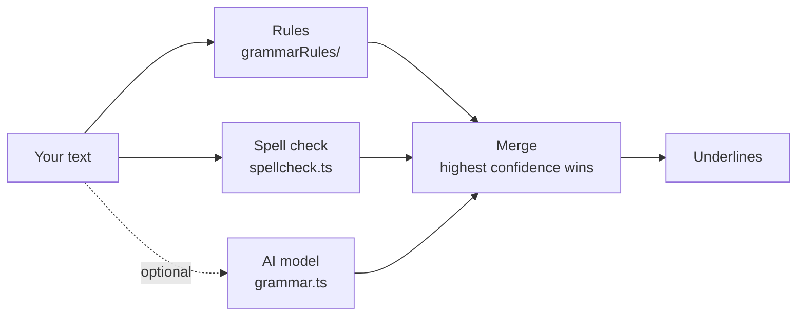

# Architecture

Grammit is built from three independent **on-device** checking layers whose
results are merged into one set of underlines. The app shell lives in
`extension/src/apps/grammit/index.ts`; the checking layers live in
`extension/src/lib/`. Nothing in this pipeline talks to a server.

## The three layers

**Layer 1 — deterministic rules** (`lib/grammarRules/`). A set of hand-written,
high-confidence rules with no model required. They run instantly and cover
misspellings from a curated typo list, contractions, the pronoun "I", sentence
capitalization, a/an, repeated words, spacing, subject–verb agreement (via a real
conjugator, both directions), double negatives, comparatives, then/than, modal +
of/to, and contextual homophones. The exported `ruleIssues(text)` returns a
sorted, non-overlapping list of issues. These rules are tuned for **no false
positives** — they only fire when the fix is unambiguous.

The typo list is in two halves for exactly that reason. Most entries are strings
that are never a word (`teh`, `recieve`, `langauge`), so they are corrected on
sight. A handful are real English as well as a common mistake — you can `wolf`
down a dinner, `leaf` through a magazine and `foot` a bill — and those are gated:
they are only corrected when a neighbouring word rules the legitimate reading out,
so "two knifes" is fixed and "he knifes the box open" is left alone. Where no
cheap test tells the two readings apart, the entry is simply not there: a missed
mistake is better than a confident wrong correction.

The phrase list is split the same way. A phrase fix is only unconditional when
the phrase has no valid English reading at all ("they is", "more better"); a
phrase that can be correct is gated on a neighbouring word, so "he said me that…"
is fixed while "he said her name" and "there is many a slip" are left alone. The
subjunctive is why some entries simply do not exist: "If I were you" and "I wish
it were true" are textbook English, and no cheap test separates them from the
matching mistake, so the checker stays silent rather than "correcting" them. Each
phrase is reviewed against a fixture of valid sentences that must stay clean, and
the build fails if an entry skips that review.

**Layer 2 — spell check** (`lib/spellcheck.ts`). A real dictionary speller backed
by a 60k-word, frequency-ordered English word list. It catches _any_ misspelling
the rule list doesn't know, and generates suggestions Norvig-style (all words
within edit distance 1–2) ranked by frequency. The word list is loaded lazily —
only the first time spell check actually runs — so opening the app costs nothing.
Guards keep it quiet on proper nouns, acronyms, short words, and known tech terms.

The list itself is **derived, not authored**: `scripts/gen-words.mjs` takes the
words of SCOWL — the curated dictionary behind hunspell's `en_US` and Aspell —
and keeps the 60,000 most frequent, ordered by a published word-frequency table.
Membership comes from the dictionary and the ordering from the frequency table,
which is what stops a common misspelling from entering the list and being treated
as a real word.

**Layer 3 — optional AI model** (`lib/engines/grammar.ts`). An on-device FLAN-T5
sequence-to-sequence model (via Transformers.js, ONNX/WASM) for deeper grammar.
It is **off by default**, downloads its files once on first use (cached in the
browser), and then runs locally. Grammit checks the text sentence by sentence,
diffs each corrected sentence against the original with `lib/textDiff.ts`, and
keeps only changes that genuinely resemble the input (rewrites and hallucinations
are rejected by `trustworthy()`).

The three layers are merged so that **higher-confidence results win**: rules
first, then spelling for spans the rules didn't cover, then any AI suggestion that
doesn't overlap an existing one.

## Modules

| File                     | Role                                                                                                                                                                |
| ------------------------ | ------------------------------------------------------------------------------------------------------------------------------------------------------------------- |
| `apps/grammit/index.ts`  | The app descriptor and UI — the editor, the underline backdrop, the suggestion popover, Fix all / Copy, debounced live checking, and merging the three layers.      |
| `lib/grammarRules/`      | Layer 1 — deterministic rules (`ruleIssues(text)` in `index.ts`, rule set in `rules.ts`, data tables in `dictionaries.ts`). Returns sorted, non-overlapping issues. |
| `lib/spellcheck.ts`      | Layer 2 — the 60k-word dictionary speller. `spellIssues(text)` returns misspellings with frequency-ranked suggestions; lazy-loaded.                                 |
| `lib/engines/grammar.ts` | Layer 3 — the optional FLAN-T5 corrector. `createCorrector()` loads the model and exposes `correct(text)`; off by default.                                          |
| `lib/textDiff.ts`        | Word-level diff (`grammarIssues`) turning a corrected sentence into underline spans, with a resemblance check to reject rewrites.                                   |
| `lib/writing.ts`         | `mergeIssues` — the merge step that combines the three layers so higher-confidence results win where spans overlap. Imported by `index.ts`.                         |

## Data flow

The AI path is dashed because it only runs when you enable "deep grammar"; the
rules and spell check always run, instantly.

## The underline technique

You can't style individual words _inside_ a `<textarea>`, so Grammit paints the
red wavy underlines on a separate **backdrop** behind it. A transparent-text
textarea sits over a backdrop "mirror" built with identical text metrics; the
backdrop re-renders the same text with each issue wrapped in a `<mark>`, so the
underlines line up exactly under the words.

The wrapper is the single scroll container and the textarea auto-grows to its
content, which keeps the backdrop and the text from ever drifting apart. A hidden
mirror element is also used to measure where a given word sits, so the suggestion
popover can be placed right beneath the underline you clicked.
