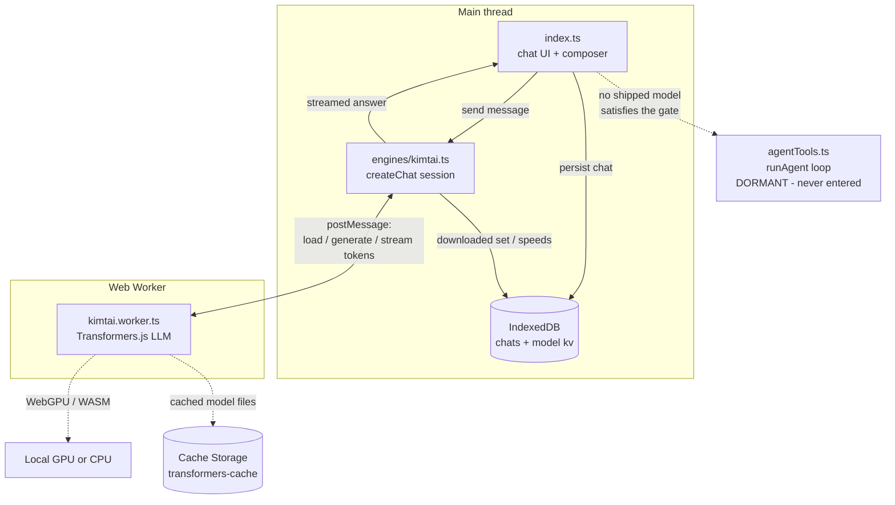

# Architecture

KimtAI has two live parts: the **app UI** (chat thread, composer, Model Library)
and the **engine** that runs the model in a Web Worker, off the main thread. The
code lives in `extension/src/apps/kimtai/` and `extension/src/lib/`.

A third part — an **agent runtime** that would let the model call the other apps'
tools — exists in the tree but is **switched off**; see _The dormant agent
runtime_ below.

## Modules

| File                           | Role                                                                                                                                                                                                                    |
| ------------------------------ | ----------------------------------------------------------------------------------------------------------------------------------------------------------------------------------------------------------------------- |
| `apps/kimtai/meta.ts`          | The app's identity — id (`kimtai`), name (**KimtAI**), accent, order, and marketing copy.                                                                                                                               |
| `apps/kimtai/index.ts`         | The app descriptor and UI — chat sidebar, thread, streaming composer, per-chat tuning, and the Model Library overlay. Answers every message with plain chat, and persists chats via the local API (`chats` collection). |
| `lib/engines/kimtai.ts`        | The on-device chat engine — the model catalog, the downloaded-models set, measured-speed tracking, cache add/remove, and `createChat()`, which spawns and talks to the worker.                                          |
| `lib/engines/kimtai.worker.ts` | The Web Worker that loads the LLM with Transformers.js (`@huggingface/transformers`), prefers **WebGPU** and falls back to **WASM**, and **streams tokens** back to the app.                                            |
| `lib/agentTools.ts`            | The **dormant** agent runtime (see below) — it would collect each installed app's `tools`, build the system prompt, parse the tool call the model emits, run it on-device and loop. Not reachable today.                |

## The dormant agent runtime

Every app in the suite declares its capabilities as an **MCP-shaped `tools` array**
on its descriptor — {{agentToolCount}} tools across {{agentToolAppCount}} apps — and
`lib/agentTools.ts` contains a complete runtime to drive them. **None of it runs.**
KimtAI answers every message with plain chat.

This is deliberate. The runtime is only as good as the model driving it, and the
models small enough to run on a user's own device are not good enough yet. Measured
on our own prompt and parser, the default model (**SmolLM2-360M**) got **1 of 6**
tool calls right — and its failures were the dangerous kind: asked _"what tasks do I
have today?"_ it answered _"You have no tasks today"_ **without ever calling the
tool**. A model that confidently reports doing something it never did is worse than
one that cannot act at all.

So the tools stay declared and the runtime stays in the tree — inert, costing
nothing at runtime — until an on-device model can be trusted with them. Keeping the
declarations means switching the feature on later is a runtime change, not
{{agentToolCount}} rewrites.

The research into which small model (if any) can do this reliably is tracked
separately, along with whether we speak MCP to anything external at all.

## How a message is answered

Every message takes the **plain chat** path: one streamed generation, no tools. The
code still contains the branch that would enter the agent loop, but no shipped model
satisfies its condition, so it is never taken.

## Flow

The model always runs in the worker; the app talks to it only through
`postMessage`. **Nothing in this diagram crosses the network except the one-time
model download.** The dashed edge to the agent runtime is the path that is never
taken.

## Storage

- **Chats** live in the shared IndexedDB `chats` collection, saved through the
  suite's local API (`getApi` / `jsonApi`) — the same router the other apps use.
- **Model files** are cached by Transformers.js in Cache Storage
  (`transformers-cache`); removing a model deletes only that model's cache keys.
- **Which models are downloaded** and their **measured speeds** are tracked in the
  shared key/value store (`kimtai:downloaded`, `kimtai:speed`), and per-chat
  settings persist per conversation.
