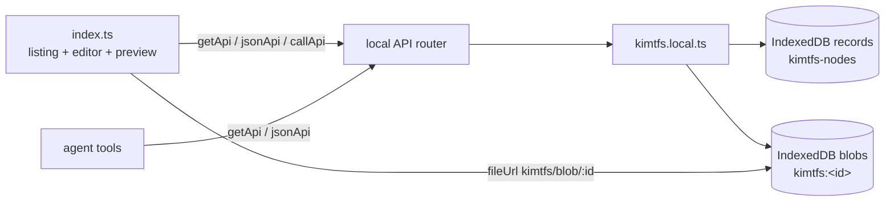
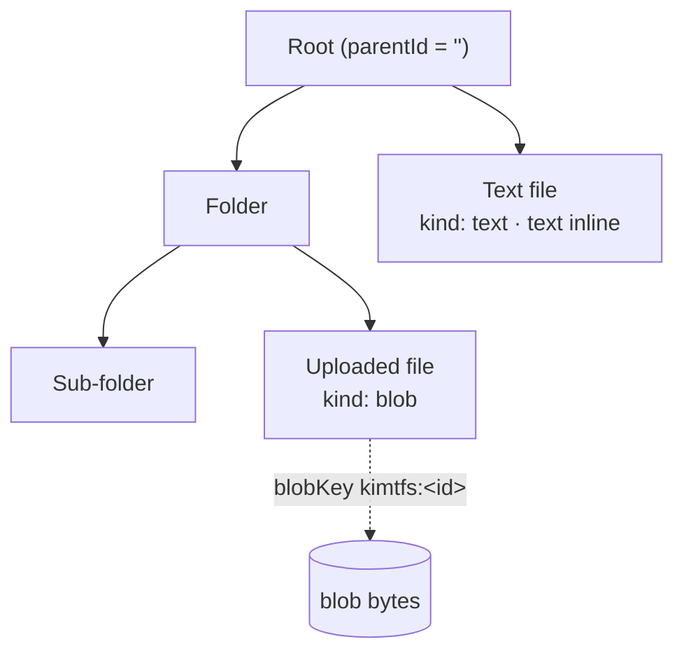

# Architecture

KimtFS follows the suite convention: **all data logic lives behind the local API
layer**, and the app itself is UI plus client-side file preview. The code lives
in `extension/src/apps/kimtfs/`.

## Modules

| File              | Role                                                                                                                                                                                                                                                                                  |
| ----------------- | ------------------------------------------------------------------------------------------------------------------------------------------------------------------------------------------------------------------------------------------------------------------------------------- |
| `meta.ts`         | The app manifest — id (`kimtfs`), display name (KimtFS), accent, order, and App Store marketing copy.                                                                                                                                                                                 |
| `index.ts`        | The app descriptor and UI — the path bar, the listing (columns or grid; sort, search, keyboard, multi-select), the text editor / file viewer, drag-and-drop, right-click context menus, Get Info, confirm-then-undo delete, and the agent `tools` array.                              |
| `listing.ts`      | The rules behind the column list, kept free of the DOM so they can be tested: the Kind label, the sort comparator (folders first in **both** directions), the recursive search, and the Modified format.                                                                              |
| `viewer.ts`       | What you see when you open a file: the kind is detected from the **name** first (the mime type is the OS's guess, and it is often wrong), then rendered — image, audio, video, PDF (`pdfjs-dist`, imported lazily), JSON, code, or a capped hex dump.                                 |
| `zip.ts`          | The ZIP container, written by hand — local headers, the central directory, the end-of-central-directory record and a CRC-32. The compression itself is the browser's: `CompressionStream('deflate-raw')`. No dependency, and an entry is only inflated when it is actually extracted. |
| `migrate.ts`      | The one-time copy of the old `homefs-*` partitions to `kimtfs-*`. Copies before it deletes, and is idempotent by construction.                                                                                                                                                        |
| `kimtfs.local.ts` | The data layer — folder/file/upload CRUD and blob storage over the shared IndexedDB, registered on the local API router. Every route awaits the migration first.                                                                                                                      |
| `kimtfs.css`      | The app's styles for the path bar, the listing (columns and grid), the editor, and the viewers.                                                                                                                                                                                       |

## Data flow

The UI never touches storage directly: it calls `getApi` / `jsonApi` / `callApi`
(the suite's local router), which dispatches to `kimtfs.local.ts`. Uploaded-file
previews and downloads resolve a local object URL through `fileUrl` on the
`kimtfs/blob/:id` route. The agent tools go through the same routes as the UI, so
the assistant and the interface stay in sync.

## Data model

Everything is a **node** in the `kimtfs-nodes` records collection, and the tree
is formed entirely by the `parentId` link:

- **Folder** — `{ id, parentId, type: 'folder', name, createdAt, updatedAt }`.
- **Text file** — `{ id, parentId, type: 'file', kind: 'text', name, text,
size, createdAt, updatedAt }`, where `text` is the inline content (capped at
  200,000 characters) and `size` is its character length.
- **Uploaded file** — `{ id, parentId, type: 'file', kind: 'blob', name, size,
mime, blobKey, createdAt, updatedAt }`. The file's **bytes** live separately in
  the blobs store under the key `kimtfs:<id>`.

A `parentId` of `''` (empty) places a node at the **root**. Listings return a
"lean" view of each node (no inline text) for the tree; a file's full content is
fetched only when it is opened.

## Storage and operations

All persistent data goes through the shared `dataStore` (the single `kimtos`
IndexedDB), partitioned by the app id:

- **Records** in the `kimtfs-nodes` collection hold every folder and file node.
- **Blobs** hold uploaded file bytes, keyed `kimtfs:<id>` for object-URL access.

Because both partitions are prefixed with the app id, AnubisDB attributes them to
KimtFS automatically.

Key behaviors in the data layer:

- **Recursive delete** — deleting a folder walks its whole subtree and removes
  every descendant node, freeing each uploaded blob as it goes.
- **Move guards** — a folder can't be moved into itself or into one of its own
  subfolders; both cases are rejected.
- **Text limit** — creating or editing a text file over the 200,000-character
  limit is rejected. The UI checks the same limit before it opens an uploaded file
  for editing, so a file too big to save is never offered as editable.
- **Autosave** — text edits are **debounced** (~500 ms after the last keystroke)
  before being persisted via a `PATCH`.
- **An edit goes where the bytes are** — a `PATCH` carrying `text` updates the inline
  `text` field of a file created in the app, but **rewrites the blob** of an uploaded
  one. Writing the inline field on a blob node would leave the real bytes untouched
  and lose the edit.
- **Delete-with-undo** — the UI soft-hides a deleted item for ~6 seconds and only
  commits the recursive delete to storage if the undo window lapses.

## Agent tools

KimtFS declares its capabilities as an MCP-shaped `tools` array on the app
descriptor, for a future on-device assistant (they are dormant — no shipped model
can run them). Each tool would run on-device through the same local routes as the
UI:

| Tool            | Purpose                                                                                                         |
| --------------- | --------------------------------------------------------------------------------------------------------------- |
| `list_files`    | List every folder and file with `id`, `name`, `type`, `kind`, and `parentId` — used to find an item's id first. |
| `create_folder` | Create a folder under an optional `parentId` (root if omitted).                                                 |
| `create_file`   | Create a text file with optional content under an optional `parentId`.                                          |
| `read_file`     | Read a text file's content by id; uploaded files return their metadata.                                         |
| `update_file`   | Replace a text file's content by id.                                                                            |
| `rename_item`   | Rename a folder or file by id.                                                                                  |
| `delete_item`   | Delete a folder (and everything inside it) or a file by id.                                                     |

Following suite conventions, these tools never throw — for a missing item or a
validation failure they return an `ok: false` result an assistant could recover
from — and their compact string results list ids so follow-up tool calls could
reference them. (They are dormant: no shipped model can call them.)
