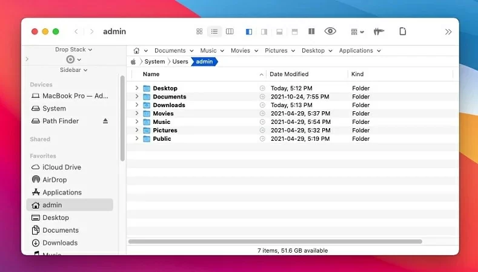

# KimtFS — design reference

The reference for the KimtFS redesign ([#188](https://github.com/MoonLandingLabs/kimtos-core/issues/188)).
Kept in the repo rather than pasted into the issue so it survives, and so the redesign can be
reviewed against something concrete.

It is a **reference, not a skin**. Copy the structure and the affordances below; do not copy
macOS's chrome, and never a colour — every colour in this app is a `var(--token)`, and
`scripts/check-contrast.mjs` will fail the build if a new one is illegible in either theme.

## What to take from it

**Three regions, not two.** KimtFS today is a tree plus an editor. The reference has:

1. **A sidebar of places** — grouped (`Devices`, `Shared`, `Favorites`), each row an icon plus a
   label. Ours becomes: the root, then any folder the user pins. It is navigation, not the file
   tree — the tree lives in the content pane.
2. **A content pane that is a real list** — columns (`Name`, `Date Modified`, `Kind`), a sort
   indicator on the active column, disclosure triangles for folders, alternating row bands, and
   a selected row that is visibly selected.
3. **A path bar / breadcrumb** — `System > Users > admin`, each segment clickable. This is what
   KimtFS has no equivalent of, and it is why "where will my new file land?" is currently
   unanswerable (#188, point 6).

**A toolbar that means something.** Back/forward, view switchers (list / columns / icons), and a
path/action menu. Today's toolbar is a burger, a title and a delete button.

**A status bar.** `7 items, 51.6 GB available`. Ours: the item count of the current folder and
the space used by KimtFS in IndexedDB (`navigator.storage.estimate()` gives quota and usage).

**Selection is a first-class thing.** In the reference, the selected row is unmistakable, and the
toolbar and status bar both talk about it. In KimtFS, `.is-active` marks the _open file_ — there
is no notion of a selected _folder_ at all, which is the root of the create-in-the-wrong-place
bug.

## What NOT to take

- **No macOS chrome.** No traffic lights, no vibrancy, no system fonts — the window frame is the
  shared `createDialog` shell, like every other app.
- **No new colours.** Use `--accent`, `--surface`, `--hairline`, `--text-secondary`. The blue
  Finder folder icon is a macOS icon; ours is the app's own glyph set (`@kimtos/icons`).
- **Not the density.** Finder's rows are tuned for a desktop; ours sit in a dialog inside a
  browser tab. Match the row height of Notes' and Clipboard's lists so the suite stays coherent.

## The point

The redesign is judged on whether the ordinary actions of a file manager work — select, move,
multi-select, delete safely, see what is in the file — not on whether it looks like macOS. The
screenshot is here to fix the _shape_ of the answer, not its skin.
