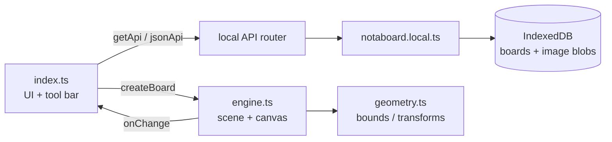
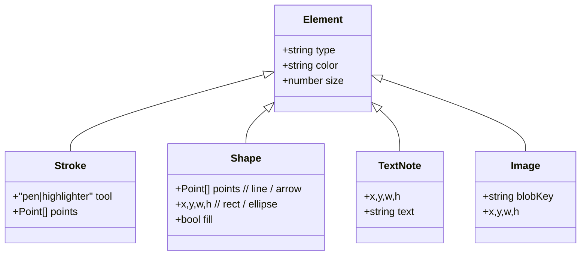

# Architecture

NotaBoard follows the suite convention: **all data logic lives behind the local
API layer**, and the app itself is UI plus a self-contained canvas engine. The
code lives in `extension/src/apps/notaboard/`.

## Modules

| File                 | Role                                                                                                                                                |
| -------------------- | --------------------------------------------------------------------------------------------------------------------------------------------------- |
| `index.ts`           | The app descriptor and UI — boards sidebar, the slim tool bar, the style/page popovers, image insert, and autosave.                                 |
| `engine.ts`          | The canvas engine — a retained-mode scene, rendering, pointer gestures, undo/redo, the in-place text editor, the minimap, and PNG/thumbnail export. |
| `geometry.ts`        | Pure, DOM-free scene primitives — element bounds and rigid transforms (translate/scale), plus hit-test maths.                                       |
| `notaboard.local.ts` | The data layer — board CRUD over IndexedDB, registered on the local API router.                                                                     |

## Data flow



The UI never touches storage directly: it calls `getApi` / `jsonApi` (the
suite's local router), which dispatches to `notaboard.local.ts`. Inserted image
blobs are written through the shared data store. The canvas engine is pure UI
state — it tells the UI _when_ something changed via an `onChange` callback, and
the UI debounces a save.

## The scene model

A board's drawing is a flat, **serializable** array of elements. Array order is
z-order (later elements paint on top). There are two geometry families:

- **Point-based** — `stroke` (pen/highlighter), `line`, `arrow`. They carry a
  `points: [{x, y}]` list.
- **Box-based** — `rect`, `ellipse`, `text`, `note`, `image`. They carry
  `x, y, w, h`.



> The `classDiagram` above is a quick reference. Because every element is plain
> data with no DOM or image references, a board can be cloned, diffed, undone,
> and saved as one JSON blob.

## Rendering

The engine draws the whole scene to a single `<canvas>` once per animation frame,
under a pan/zoom transform, in **world coordinates**:

```
screen = world * scale + offset
```

Drawing is dirty-flagged: mutations call `requestRender()`, which coalesces work
into one `requestAnimationFrame`. Inserted images are cached as `HTMLImageElement`
objects keyed by blob key and resolved lazily.

`geometry.ts` keeps the engine honest: bounds, translate, and scale are pure
functions over the element data, identical whether they run for hit-testing,
selection handles, the minimap, or export.

## History, editor, and export

- **Undo / redo** snapshots the element array before each committed gesture
  (capped depth), so any change is reversible.
- The **text/note editor** is a real `<textarea>` overlaid on the canvas at the
  element's screen position; on commit it writes back into the scene.
- **Export & thumbnails** reuse the same draw routines against an off-screen
  canvas, so a PNG (or the sidebar thumbnail) is pixel-faithful to the board.

## Persistence

Each board is one IndexedDB record:

```
{ id, title, elements[], paper, theme, thumb (dataURL), created, updated }
```

Saves are debounced (~700 ms) and also write a fresh thumbnail. Deleting a board
removes its record and purges its image blobs. Reopening the app restores the
most recently edited board and renders it straight from storage.
