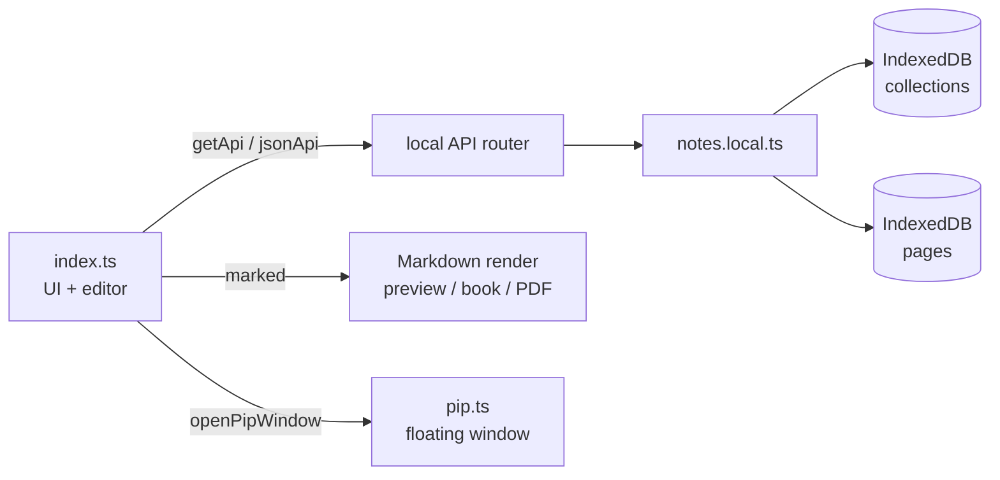

# Architecture

Notes follows the suite convention: **all data logic lives behind the
local API layer**, and the app itself is UI plus client-side Markdown rendering.
The code lives in `extension/src/apps/notes/`.

## Modules

| File                                           | Role                                                                                                                                                                                                                                                                                                                                                                                 |
| ---------------------------------------------- | ------------------------------------------------------------------------------------------------------------------------------------------------------------------------------------------------------------------------------------------------------------------------------------------------------------------------------------------------------------------------------------ |
| `index.ts`                                     | The app descriptor and UI — the collections/pages sidebar tree, the Markdown editor (Edit/Split/Preview), find & replace, internal links, Export as Book, PDF/`.md`/`.zip` export, and the floating-window control.                                                                                                                                                                  |
| `notes.local.ts`                               | The data layer — collections and pages CRUD over IndexedDB, registered on the local API router. Includes a one-time migration of legacy flat notes into a "My Notes" collection.                                                                                                                                                                                                     |
| `bookSection.ts`                               | Builds one page of the Book view / PDF / `.md` export. In the book and the PDF a page's name is never Markdown — a heading node, or escaped HTML — so `*` and `#` in it survive verbatim. In a `.md` file the name is a real heading; only its whitespace is collapsed, so it cannot split across lines.                                                                             |
| `previewDiff.ts`                               | The pure half of the incremental live preview — diffs the previous and next lists of top-level Markdown blocks so a one-paragraph edit re-renders one block instead of the whole page.                                                                                                                                                                                               |
| `listContinuation.ts`                          | The pure half of Enter-continues-a-list — given the source and the caret, it returns the range to replace and the text to put there (a new marker, or nothing when an empty item ends the list). No DOM, so every rule is a unit test.                                                                                                                                               |
| `taskToggle.ts`                                | Maps the checkbox a user clicked in the preview back to the exact `[ ]` / `[x]` in the source. Uses `marked`'s lexer to skip code blocks rather than a line regex, because a `- [ ]` inside a fenced block renders no checkbox and must not be counted. Nested list `raw` comes back de-indented, so offsets are found by scanning source lines rather than by walking child tokens. |
| `print.ts`                                     | The PDF export path — renders the already-rendered Markdown HTML to PDF through the browser's own print-to-PDF (offscreen iframe → print dialog → "Save as PDF"), with a light syntax theme injected into the print document.                                                                                                                                                        |
| `marked` + `marked-highlight` + `highlight.js` | Client-side Markdown parsing and code syntax highlighting, used for the live preview, Book view, and export.                                                                                                                                                                                                                                                                         |
| `lib/pip.ts`                                   | The Document Picture-in-Picture helper that pops the UI out into an always-on-top floating window.                                                                                                                                                                                                                                                                                   |

## Data flow

The UI never touches storage directly: it calls `getApi` / `jsonApi` (the
suite's local router), which dispatches to `notes.local.ts`. Markdown rendering
is purely a view concern — `marked` parses the source for the preview, the Book
view, and PDF export, but the source of truth is always the plain Markdown text
in storage.

## Data model

Two record types, linked by id:

- **Collection** — `{ id, name, updated }`. Its `updated` time is bumped whenever
  any of its pages changes, so the "recent" ordering reflects real activity.
- **Page** — `{ id, collectionId, title, content, updated }`, where `content` is
  the Markdown text (capped at {{noteMaxChars}} characters).

Listing a collection returns a live page count; deleting a collection cascades to
remove all of its pages. Moving a page rewrites its `collectionId` and bumps both
the old and new collections' timestamps.

## Persistence

Saves are **debounced** (~600 ms after the last keystroke) and flushed
immediately before switching pages, so a fast switch never drops an edit.
Deletes (and moves) are reversible for 30 seconds through an in-app undo toast
that re-creates the removed records. Reopening the app restores the most recently
edited collection and opens its first page straight from storage.
