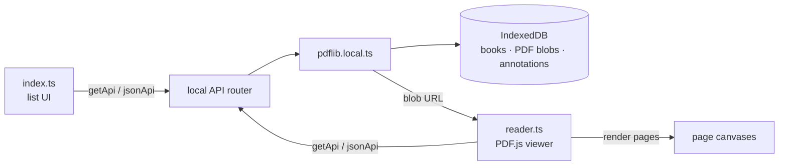

# Architecture

PDF Library follows the suite convention: **all data logic lives behind the local
API layer**, and the app itself is UI plus a self-contained PDF.js reader. The
code lives in `extension/src/apps/pdflib/`.

## Modules

| File              | Role                                                                                                                                                                                                                                                                                 |
| ----------------- | ------------------------------------------------------------------------------------------------------------------------------------------------------------------------------------------------------------------------------------------------------------------------------------ |
| `index.ts`        | The app descriptor and list UI — add-by-URL / upload form, the All / Unread / Read filters, the read checkbox and remove/batch-delete, the dock unread badge, and the "Continue reading" home widget.                                                                                |
| `reader.ts`       | The in-app reader — a PDF.js continuous viewer with on-demand page rendering, manual zoom, a live page indicator, last-page memory, cross-chunk text search & highlight, and the highlights / comments / annotations sidebar. Loaded lazily, so PDF.js stays out of the main bundle. |
| `pdflib.local.ts` | The data layer — book CRUD, stored PDF blobs, and annotation CRUD over IndexedDB, registered on the local API router.                                                                                                                                                                |
| `download.ts`     | Saving a stored PDF back to disk — used by both the list row and the reader toolbar, so the two name the file and report a failure the same way. Read-only: it resolves the stored blob to an object URL and never writes.                                                           |

## Data flow



The UI never touches storage directly: both the list and the reader call
`getApi` / `jsonApi` (the suite's local router), which dispatches to
`pdflib.local.ts`. To display a book, the reader asks the data layer for a blob
URL of the stored PDF, hands it to **PDF.js**, and renders each page to a
`<canvas>` as it scrolls into view.

## The reader

The reader stacks one wrapper per page and renders lazily:

- An **IntersectionObserver** renders pages as they approach the viewport (with a
  buffer) and unloads pages that scroll far away, to bound memory.
- Pages render at the chosen **zoom** only; the page wrappers are pre-sized so the
  scrollbar and page indicator stay correct before a page has drawn.
- A **text layer** over each canvas powers selection, search highlights, and a
  separate **highlight layer** whose rectangles are positioned in percentages of
  the page box — so annotations track zoom for free.
- **Search** builds a whitespace-stripped string of each page's text (cached) to
  find matches across chunk boundaries, then wraps exactly the matched characters
  in `<mark>` elements.

## Persistence

Three kinds of record back the app:

```
book        { id, title, url, source, read, added, lastPage, lastReadAt, zoom }
PDF blob    key "pdf:<bookId>"  →  the stored PDF file
annotation  { id, bookId, page, rects[], text, color, comment, created }
```

Reading progress (`lastPage`, `lastReadAt`) and `zoom` are saved with a short
debounce as you read. Highlight geometry is stored as **normalized rects**
(fractions of the page), so it renders correctly at any zoom. Deleting a book
removes its record, its stored PDF blob, and all of its annotations.
