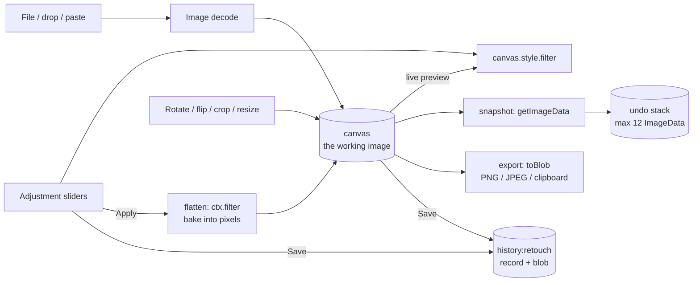

# Architecture

Retouch is **UI plus a canvas**, with a thin library on top of the shared data
store. The code lives in `extension/src/apps/retouch/`.

## Modules

| File          | Role                                                                                                                                                                                                                   |
| ------------- | ---------------------------------------------------------------------------------------------------------------------------------------------------------------------------------------------------------------------- |
| `index.ts`    | The whole app — the descriptor, the dropzone, the toolbar, the crop editor, the adjustment panel, the undo stack, the saved-image library, and export.                                                                 |
| `crop.ts`     | Pure crop-selection geometry — projecting the pixel selection to and from the on-screen box, resolving handle/move drags, aspect presets, and clamping. Split out so it is unit-tested without a DOM (`crop.test.ts`). |
| `zoom.ts`     | Pure zoom-step maths — the stops the `-`/`+` buttons walk through, stepping from a measured Fit scale, and clamping. Unit-tested in `zoom.test.ts`.                                                                    |
| `retouch.css` | Colocated styles — the checkerboard backdrop, the toolbar, the zoom controls, the crop overlay (handles, rule-of-thirds grid, removed-area mask) and the slider panel.                                                 |
| `meta.ts`     | Identity — id, name, accent (`#f43f5e`), order, `optIn: true`.                                                                                                                                                         |

There is deliberately **no `retouch.local.ts`**. Saved images are a flat list of
records plus one blob each, which is exactly what the shared `createBlobHistory`
helper already provides, so there are no app-specific routes to register.

## Saved images

Retouch uses the same three shared pieces as Denoise and Screen Recorder, so
there is nothing bespoke to maintain:

- **`createBlobHistory('history:retouch')`** (`lib/blobHistory.ts`) — newest-first
  listing, blob-aware delete, and newest-24 pruning over the shared `dataStore`.
  The `history:<appId>` name is the storage convention, which is what makes
  AnubisDB attribute the data to Retouch with no registry edit.
- **`createHistorySidebar`** (`components/historySidebar.ts`) with
  `selectable: true` — the row list, the right-click menu (Delete is built in;
  Retouch adds Open, Rename and Download PNG), confirm-plus-undo, and
  multi-select with drag-to-select, per app convention 2.
- **`createSidebarShell`** (`components/sidebarShell.ts`) — the sidebar/main row,
  the drag resizer and the narrow-window drawer.

One record holds `{ name, at, imageKey, w, h, adjust }`; the blob at `imageKey`
holds the **raw** canvas pixels. The `adjust` field is the _pending_ (unbaked)
slider state — CSS filters never touch the bitmap, so persisting the two
separately is what lets a reopened image come back mid-edit rather than flattened.
Saving an image that is already in the library reuses its blob key, so a re-save
replaces the pixels instead of orphaning a blob.

The app declares `dataLabel` / `hasData` / `clearData`, so uninstalling offers to
erase the library.

Retouch is the first **pop-out** app to use the shared history sidebar, which
exposed a latent bug there: the sidebar opened its confirm dialog, undo toast and
context menu against the bare `document`, which in a floating window is the
opener's, not the app's. It now scopes all of them (and its drag-select
hit-testing) to its own root element, so every app gets the fix.

## How an edit works

## Why Canvas 2D, and nothing else

The adjustments are not hand-written pixel loops. They are the **native
`ctx.filter` string** — `brightness() contrast() saturate() blur() grayscale()
sepia() invert()` — which the browser applies on the GPU. That buys two things:

- **Live preview is free.** While the sliders move, the filter is set on
  `canvas.style.filter`, so the browser composites it for display without the
  pixel data changing at all.
- **Applying is one draw.** `flatten()` sets the same string as `ctx.filter` on
  an off-screen canvas, draws the image through it once, and swaps the result in.

Transforms are the same idea: rotate, flip, crop and resize are each a single
`drawImage` onto an off-screen canvas with the appropriate transform, which then
replaces the working canvas. No dependencies, no WASM, nothing to download —
which is why Retouch is the one media app that opens instantly.

Heavier or custom filters would want Photon (Rust to WASM) or a WebGPU compute
shader. The editor is structured so a filter can be swapped to such a path
without touching the UI, but v1 deliberately does not need one.

## Undo stack

`snapshot()` pushes a full `ImageData` of the canvas onto an in-memory array, and
`restore(i)` puts one back. It is a plain snapshot stack, not a command log:
simple and exact, but the memory cost is one full uncompressed frame per step.

That is the reason for the bound — **the stack is capped at 12 entries** and the
oldest is dropped beyond that. It is **not persisted**: saving an image stores its
current pixels, not its history, so reopening a saved image starts a fresh stack.
`Reset to original` is handled separately: it truncates the stack back to its
first entry, so it survives regardless of how many edits have scrolled off.

## Zoom

`zoom` is either `null` — Fit, where the canvas keeps its CSS `max-width` /
`max-height` and the browser scales it into the pane — or an explicit factor,
which pins the canvas's display size and lets the wrap scroll. Stepping starts
from the scale **currently on screen** (measured in Fit mode), so the first click
out of Fit lands on the neighbouring stop rather than jumping to 100%; that rule
is the pure `nextZoom` in `zoom.ts`.

Nothing in the crop editor knows about zoom: the overlay is projected from the
canvas's live bounding rect on every paint, and a `ResizeObserver` on the canvas
repaints it — so changing the zoom moves the selection with the image for free.

## Agent tools

Retouch declares eight tools for a future KimtAI agent. They are **dormant** — no
shipped model can call them — and none of them runs today.

Four are **stateless transforms on an attached image**
(`needs: { attachment: 'image' }`), returning the processed image as an artifact:

| Tool              | Would do                                |
| ----------------- | --------------------------------------- |
| `grayscale_image` | Desaturates the attached image.         |
| `invert_image`    | Inverts its colours.                    |
| `rotate_image`    | Rotates it 90° clockwise.               |
| `resize_image`    | Resizes it to a given width and height. |

Four cover the saved-image library, so it could be driven end to end:

| Tool           | Would do                                      |
| -------------- | --------------------------------------------- |
| `list_images`  | Lists saved images with their id, name, size. |
| `get_image`    | Reads one image's name and size by id.        |
| `rename_image` | Renames a saved image.                        |
| `delete_image` | Deletes a saved image and its pixels.         |

Interactive editing — cropping, dragging sliders — is **intentionally not
exposed**. Those need a live user gesture on a canvas, which an agent has no way
to perform, so the app follows the suite convention of only exposing actions that
are meaningful without one.
