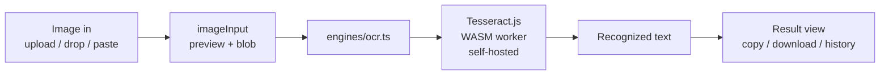

# Architecture

Image to Text is intentionally thin. It is built on the suite's shared
**media → text** factory, so the descriptor declares the copy and settings while
the heavy lifting is a single on-device OCR engine. The code lives in
`extension/src/apps/snaptext/` and `extension/src/lib/engines/`.

## Modules

| File                        | Role                                                                                                                                                      |
| --------------------------- | --------------------------------------------------------------------------------------------------------------------------------------------------------- |
| `apps/snaptext/index.ts`    | The app descriptor — id, name, accent, settings (language, layout), and the `run` hook. Wires the image input to the OCR engine via `createMediaTextApp`. |
| `lib/createMediaTextApp.ts` | The shared "media in → text out" factory — history sidebar, progress bar, result view, copy/download, and on-device data handling.                        |
| `components/imageInput.ts`  | The input control — upload, drag-and-drop, and clipboard paste, with a framed preview and validation.                                                     |
| `components/imagePanel.ts`  | The image preview frame with a **view full size** button.                                                                                                 |
| `components/lightbox.ts`    | The full-screen image viewer (a native modal `<dialog>`).                                                                                                 |
| `components/resultView.ts`  | The text result card — word count plus Copy, Download .txt, and Start over.                                                                               |
| `lib/engines/ocr.ts`        | The OCR engine — runs Tesseract.js (WebAssembly) in a self-hosted worker, sets the page-segmentation mode, and returns the recognized text.               |

## Data flow

The image is captured as a blob in the browser, handed to `recognizeText`, and
read entirely on-device. Nothing is uploaded.

## The OCR engine

`engines/ocr.ts` lazy-imports Tesseract.js and creates a worker for the chosen
language, then calls `worker.recognize(file)` and returns the trimmed text.

A few details keep it private and offline-friendly:

- **Self-hosted worker + core.** The worker script (`/ocr/worker.min.js`) and the
  WASM core (`/ocr/tesseract-core-simd-lstm.wasm.js`) are copied into the
  extension and loaded from root-relative paths. Manifest V3 forbids loading a
  worker from a CDN, and its CSP bans `blob:` workers, so `workerBlobURL` is set
  to `false` and the worker file is loaded directly.
- **Bundled English data.** For `eng`, the language data (`/ocr/eng.traineddata.gz`)
  is bundled and pointed at via `langPath`, so English OCR runs with **no
  download**. Other languages are fetched on first use from the official
  `@tesseract.js-data` packages on jsDelivr (Tesseract.js's default) and are then cached.
- **Progress reporting.** A logger normalizes Tesseract's status into a
  `{ phase, label, ratio }` shape — `download` while loading the core/language,
  `recognize` while reading the image — which drives the progress bar.

A companion `prefetchOcr` helper warms the engine (compiles the WASM and loads
the bundled English data) ahead of time, so the first real recognition is
instant.

## Small text on a large page

Tesseract sizes a page from its **dominant** text and quietly discards anything
far below that size as noise — a 24px footer under a 96px headline is dropped
entirely, while the same footer alone on the same canvas reads perfectly. The
engine closes that gap with a recovery pass (`engines/ocrSmallText.ts`): after
the main read it scans the image once for horizontal bands of ink, picks out the
bands that are much thinner than the page's dominant text **and** that the main
read did not return, then crops just those slivers, enlarges them, and reads
them on their own. Recovered lines are spliced back into the text at the place
they appear on the page. An image whose text is all one size skips the rescan
entirely, so the common screenshot pays only a single cheap scan.

## Why on-device

Because the worker, core, and English data are all served from the extension and
run as WebAssembly in the browser, Image to Text needs no server and no network
for English. The model downloads (when needed) once and is cached; after that it
runs offline, and your image stays on the device.
