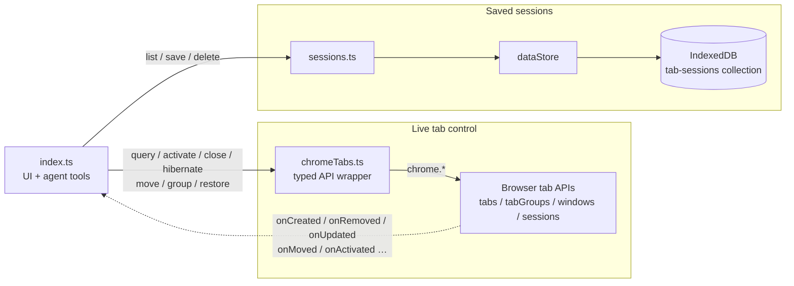

# Architecture

Tabs is split cleanly in two: a thin, typed wrapper over the **browser tab
APIs** for all live tab control, and a small **data layer** over the shared
local IndexedDB for saved sessions. The UI sits on top of both, and the same two
layers back the agent tools — so tools and UI can never drift. The code lives in
`extension/src/apps/tabs/`.

## Modules

| File            | Role                                                                                                                                                                                                                                                                                       |
| --------------- | ------------------------------------------------------------------------------------------------------------------------------------------------------------------------------------------------------------------------------------------------------------------------------------------ |
| `meta.ts`       | The app manifest — id, name, accent, order, and App Store marketing copy.                                                                                                                                                                                                                  |
| `index.ts`      | The app descriptor and UI — the fuzzy finder, windows overview, per-tab and group menus, drag-to-reorder/move, recently-closed and saved-session sections, batch select, plus the KimtAI agent `tools` array.                                                                              |
| `chromeTabs.ts` | A typed wrapper over the browser's `tabs` / `tabGroups` / `windows` / `sessions` APIs: the runtime permission check/request, querying windows and groups, activate/close/hibernate/move/pin, group create/rename/recolor/ungroup, recently-closed read/restore, and a change subscription. |
| `sessions.ts`   | The saved-session data layer — list / save / delete over the shared `dataStore` (the `tab-sessions` IndexedDB collection).                                                                                                                                                                 |
| `tabs.css`      | The app's styles.                                                                                                                                                                                                                                                                          |

## Permissions

Tabs uses Chrome **optional** permissions — `tabs`, `tabGroups`, and
`sessions` — requested at runtime from a user click, not declared up front for
everyone. On open, the app checks `chrome.permissions.contains`; if the
permission is missing it shows a gate whose button calls
`chrome.permissions.request` (which must run from a gesture). `tabGroups` and
`sessions` degrade gracefully: if unavailable, the app simply shows no groups
and no recently-closed list.

## Data flow

The UI never calls the raw `chrome.*` APIs itself: it goes through
`chromeTabs.ts`, which keeps all the browser guards and type conversions in one
place. Live tab state is never cached to disk — it is queried on demand and kept
fresh by subscribing to the browser's tab events (`onTabsChanged`), which
re-scans and re-renders whenever a tab is opened, closed, moved, or navigated.
Only **saved sessions** are persisted, through `sessions.ts` → `dataStore` into
the local `tab-sessions` collection.

## Saved-session data model

A session is one record:

- **Session** — `{ id, name, tabs[], createdAt }`, where each entry in `tabs` is
  a **SavedTab** `{ title, url, favIconUrl }`.

Only `http`/`https` tabs are saved. `listSessions` returns sessions
newest-first; saving trims the name (defaulting to a count-and-timestamp label);
reopening creates a new window from the saved URLs. The collection is named with
the app-id prefix (`tab-sessions`), so it appears — attributed to "Tabs" — in
the suite's AnubisDB storage console with no extra wiring.

## Agent tools

The descriptor declares an MCP-shaped `tools` array for a future on-device KimtAI
agent (they are dormant — no shipped model can run them): `list_tabs`,
`switch_tab`, `close_tab`, `hibernate_tab`, `save_session`, `list_sessions`,
`open_session`, and `delete_session`. Each tool
runs through the very same `chromeTabs.ts` / `sessions.ts` functions as the UI. A
shared guard first checks that Tabs is running as an extension and that the
permission is granted, returning a friendly message (rather than throwing) when
it needs the user to open the app and grant access.
