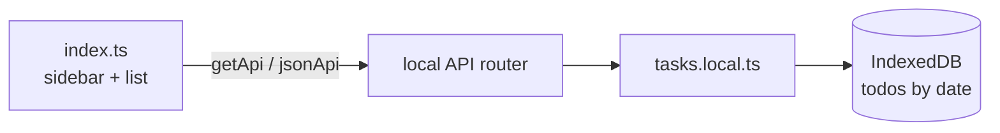

# Architecture

Tasks follows the suite convention: **all data logic lives behind the local
API layer**, and the app itself is UI. The code lives in
`extension/src/apps/tasks/`.

## Modules

| File             | Role                                                                                                                                                                     |
| ---------------- | ------------------------------------------------------------------------------------------------------------------------------------------------------------------------ |
| `index.ts`       | The app descriptor and UI — the day sidebar, the per-day task list, the add/edit composer, done toggles, multi-select batch delete, the dock badge, and the home widget. |
| `tasks.local.ts` | The data layer — task CRUD, the per-date summary, and the pending/overdue query over IndexedDB, registered on the local API router.                                      |

## Data flow

The UI never touches storage directly: it calls `getApi` / `jsonApi` (the
suite's local router), which dispatches to `tasks.local.ts`.

## The data model

Todos are stored as **flat records**, each carrying its own `date`, `title`,
`description`, `done` flag, and a `created` timestamp. There is no per-day
container in storage — the day-by-day view you see is **reconstructed by
grouping** records on their `date`:

- **`GET todos?date=…`** returns one day's tasks, sorted by creation order.
- **`GET todos/dates`** groups every record by `date` and reports, per day, how
  many are open and how many total — this drives the sidebar dots and the dock
  badge.
- **`GET todos/pending?today=…`** returns today's open tasks plus **overdue**
  ones (open tasks whose `date` is earlier than today), feeding the home widget.

Keeping todos flat means a task can move conceptually from "today" to "overdue"
with no data change at all — only the `today` value the query is compared
against moves forward, so yesterday's unfinished work naturally carries over.
