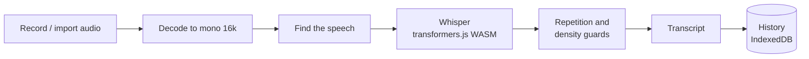

# Architecture

Voice to Text follows the suite convention: the app itself is a thin **descriptor**
built on a shared factory, and the heavy lifting is a self-contained, on-device
transcription engine. The code lives in `extension/src/apps/televoica/`.

## Modules

| File                              | Role                                                                                                                                                     |
| --------------------------------- | -------------------------------------------------------------------------------------------------------------------------------------------------------- |
| `apps/televoica/index.ts`         | The app descriptor — name, accent, settings (model, language, recording source), and the audio-input and transcribe wiring. Built by the shared factory. |
| `lib/createMediaTextApp.ts`       | The "media in → text out" factory — input screen, live progress, the transcript card, the history sidebar, and multi-select delete.                      |
| `lib/engines/transcribe.ts`       | The transcription engine — loads Whisper via Transformers.js (WebAssembly), decodes audio, runs recognition, and disposes the session.                   |
| `lib/speechSpans.ts`              | The speech gate — finds the stretches of a recording that hold speech, so the quiet ones are never shown to the model.                                   |
| `lib/engines/transcriptFormat.ts` | Transcript assembly — paragraphs from the model's segments, plus the repetition and density guards that catch invented text.                             |
| `components/audioInput.ts`        | The reusable audio input — record from the mic (with a timer) or drag/drop and import a file.                                                            |
| `components/resultView.ts`        | The transcript card — text area, word count, and Copy / Download / Start over actions.                                                                   |
| `components/historySidebar.ts`    | The history sidebar — list of past transcripts with open, per-row menu, and drag/select bulk delete.                                                     |
| `lib/dataStore.ts`                | The local data store — transcript records and their audio blobs, kept in IndexedDB.                                                                      |

## Data flow



The factory collects a clip from the audio input, runs it through
`transcribeAudio`, and renders the result. On success it saves the transcript text
**and** the original recording to the per-app history, so a past run can be reopened
and replayed.

## The transcription engine

`engines/transcribe.ts` runs entirely on-device:

- **Model.** A Whisper automatic-speech-recognition pipeline is loaded with
  `@huggingface/transformers`, on the `wasm` device with `fp32` weights for Tiny and
  Base. (The q4 exports of these models ship broken scales that crash the runtime, so
  full precision is used for reliability. Small's fp32 export is about 1 GB, so it
  loads the int8 export instead.)
- **Audio decoding.** Any browser-supported clip is decoded to the **mono 16 kHz**
  Float32 samples Whisper expects, mixing down multi-channel audio.
- **The speech gate.** Whisper never declines: shown silence or room tone it invents
  text, and once it starts it repeats one phrase for hundreds of characters. So
  `speechSpans` measures the samples first and returns only the stretches that hold
  speech; each is transcribed on its own and everything between them is withheld from
  the model. A recording with no speech in it never loads the model at all, and shows
  "No speech detected".
- **Recognition.** Each stretch is transcribed in 30-second chunks with overlap; an
  optional language is passed through when set.
- **The output guards.** Energy alone cannot tell a voice from music, so the transcript
  is checked as well: a phrase repeated four times or more is collapsed to one, and a
  long stretch of sound that comes back as a couple of words is dropped rather than
  shown. Both are pure functions in `engines/transcriptFormat.ts`.
- **Caching & memory.** The model **files** are cached after the first download (in
  Cache Storage), so later runs need no network. The in-memory session is the heavy
  part (hundreds of MB), so the pipeline is **disposed after each run** to free the
  tab's memory while idle — the cached files keep the next run fast.

> Onboarding can call `prefetchModel` to download and cache the model ahead of time
> (then immediately dispose the session), so the first real transcription is instant.

## Persistence

Each transcript is one IndexedDB record alongside a blob for its recording:

```
{ id, text, at, blobKey, mime, name }   // record
blobKey -> the original audio clip       // blob
```

The list is capped to the most recent entries; older ones are trimmed on save.
Deleting a transcript removes its record and its audio blob. Uninstalling the app
can clear the whole history collection and its blobs, and free the cached Whisper
model files.
