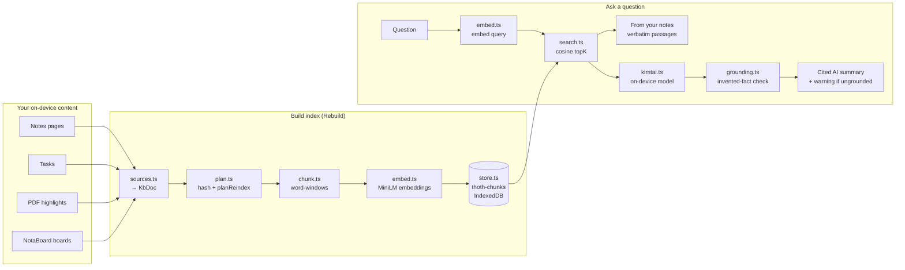

# Architecture

Thoth is a **retrieval-augmented generation (RAG)** pipeline that runs entirely
on-device. The code lives in `extension/src/apps/thoth/`, and it leans on two
shared engines — one for embeddings, one for chat — plus the suite's shared
IndexedDB. Every module that makes _decisions_ (what to index, how to chunk, how
to score) is kept pure and free of storage or model imports, so the plumbing and
the logic can be tested and reasoned about separately.

## Modules

| File                    | Role                                                                                                                                                                                                                                           |
| ----------------------- | ---------------------------------------------------------------------------------------------------------------------------------------------------------------------------------------------------------------------------------------------- |
| `index.ts`              | The app descriptor and UI — the index-status header, **Rebuild index** button, the ask box, the retrieved _From your notes_ passages, and the streamed, grounding-checked AI summary. Also declares the `search_knowledge` agent tool.         |
| `grounding.ts`          | Pure grounding check over the generated summary (#913) — any number, time or figure it asserts that the retrieved passages (and question) never mention is reported as invented, reusing the numeric-fact scanner from `lib/rephraseCheck.ts`. |
| `sources.ts`            | Pure mappers turning a raw stored record from each source app into a `KbDoc` (`app`, `docId`, `title`, `text`). Defines `SOURCES` — the collections indexed: Notes `pages`, Tasks `todos`, PDF `annotations`, NotaBoard `boards`.              |
| `chunk.ts`              | Splits a document into overlapping word-windows (default 180 words, 30 overlap) small enough to embed well but large enough to carry context. Pure.                                                                                            |
| `plan.ts`               | Pure indexing decisions — an FNV-1a content `hashString`, `docKeyOf` (`${app}:${docId}`), and `planReindex`, which compares current hashes against stored ones to decide what to (re)index and what to drop.                                   |
| `indexer.ts`            | Orchestration — `indexStatus`, `reindex` (gather → plan → chunk → embed → store), and `search` (embed the query, cosine-match stored chunks).                                                                                                  |
| `search.ts`             | Brute-force cosine similarity and `topK` over the stored chunk vectors — a linear scan, plenty fast for a personal-scale index. Pure.                                                                                                          |
| `store.ts`              | The on-device vector store over the shared IndexedDB (`dataStore`): `StoredChunk` records in the `thoth-chunks` collection, plus the content-hash map. Vectors persist as `Float32Array` via structured clone.                                 |
| `lib/engines/embed.ts`  | On-device embeddings via Transformers.js — `Xenova/all-MiniLM-L6-v2` (ONNX/WASM), producing 384-dim L2-normalized vectors so cosine equals a dot product.                                                                                      |
| `lib/engines/kimtai.ts` | The on-device chat engine — a small instruction-tuned model (SmolLM2 360M by default) run in a Web Worker that streams the answer token by token.                                                                                              |

## The RAG flow

## Indexing

`reindex` gathers every source document, computes a content hash for each, and
asks `planReindex` what changed. Documents that are **new or changed** lose any
old chunks and are re-chunked and re-embedded; documents you **deleted** simply
have their chunks removed. Unchanged documents are skipped entirely, so a
rebuild after a small edit only touches what moved. Each resulting chunk is
stored as a `StoredChunk` — `{ id, docKey, app, docId, title, text, vector }` —
where `docKey` (`${app}:${docId}`) groups all chunks of one document and `docId`
is what a citation uses to reopen the original record. The hash map is then
written back so the next build has a fresh baseline.

## Retrieval and answering

Asking a question runs the right-hand stages of the diagram. The query is
embedded with the same MiniLM model, and `topK` does a brute-force cosine scan
over every stored vector, keeping the best matches above a minimum similarity
(the app retrieves 6 passages by default, dropping ones below `0.2` so unrelated
chunks don't pad the context). The matching passages are shown **immediately and
verbatim** under _From your notes_ — they are the reliable part of the pipeline,
and they stay up even if the model then fails. The same passages, formatted with
their `[n]` labels and app/title, are handed to the on-device chat model behind
a system prompt that tells it to **answer using only that context and cite
sources inline**, at a low temperature. The summary streams back token by token
and is then checked by `grounding.ts`: a small model can misstate a detail even
with the passage in front of it, so a number, time or figure the summary asserts
that the passages never mention is flagged as invented, with a warning pointing
the reader at the passages.

## The `search_knowledge` agent tool

The descriptor declares one MCP-shaped tool, `search_knowledge`, for a future
on-device assistant (dormant today — no shipped model can call it). It would
retrieve from the private index: it takes a `query` and an
optional `limit` (default 6, max 12), checks that the index is non-empty,
embeds the query, runs the same `search`, and returns the matching passages
formatted with `[n]` citations for the model to quote. It is **read-only** — it
never modifies the index — and if the index is empty it returns a message asking
the user to build it in Thoth first.
