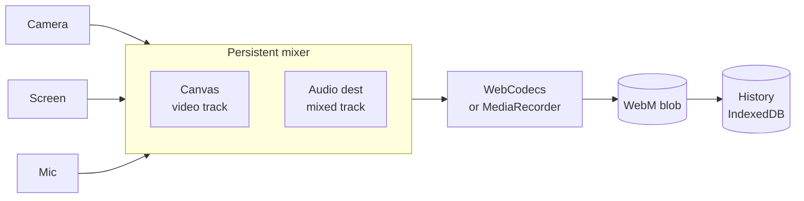

# Architecture

Video Recorder is built around one idea: **record a stable pair of tracks while the
real inputs change underneath them.** That is what lets you toggle camera, screen,
and mic at any time — even mid-recording — without the clip ever breaking. The code
lives in `extension/src/apps/vidrec/`.

## The persistent mixer trick

A `MediaRecorder` (or a WebCodecs encoder) does not like tracks appearing and
disappearing — stop a camera mid-recording and the recording falls apart. So the
app never records the camera or screen directly. Instead, when the studio opens it
creates a **persistent mixer** that exposes exactly two outputs for the whole
session:

- **One canvas video track.** A fixed-size `<canvas>` (sized to the quality preset)
  is redrawn ~30 times a second. Each frame it paints the screen (contained), then
  the camera — as a corner bubble over the screen, or full-frame on its own, and
  mirrored unless you turned mirror off. The bubble is clipped to a rounded-rect
  path, which is what makes the circular shape free: a circle is a square box
  rounded by half its width. Either way the camera is cover-cropped into the box,
  never stretched to it. This canvas _is_ the live preview shown in the page, so the
  preview and the recording are always identical.
- **One mixed-audio track.** A Web Audio `MediaStreamDestination` is the single
  audio output. The mic, and optionally the shared screen's audio, are connected to
  it as source nodes.

The camera, screen, and mic streams are the **swappable inputs**. Toggling a source
acquires or releases that real stream and points the mixer at it (`setScreen`,
`setCamera`, `setMic`, `setScreenAudio`, `setMirror`, `setBubble`) — but the mixer's
two output tracks never change. `setMirror` and `setBubble` only set state the draw
loop reads on its next tick, and `setScreenAudio` only connects or disconnects an
audio node on the graph that already feeds the output track — which is why mirroring,
system audio and the whole camera bubble can be changed mid-recording without
re-acquiring anything or touching a track. The recorder is wired to those two outputs once, so it keeps
running smoothly while inputs come and go. The source `<video>` elements are kept
attached off-screen so the browser does not suspend their decoding, and the mic is
muted by flipping its track's `enabled` flag rather than re-acquiring it.

When you stop, if **Reduce noise** is on, the clip is run through an on-device
denoise model and then re-muxed: the video is played back while the cleaned audio
is fed alongside it and the pair is re-recorded (browsers cannot swap an audio
track in place). The result is saved to history.

## Modules

| File                           | Role                                                                                                                                                                                                                                                                                              |
| ------------------------------ | ------------------------------------------------------------------------------------------------------------------------------------------------------------------------------------------------------------------------------------------------------------------------------------------------- |
| `index.ts`                     | The app descriptor and UI — the studio preview, the action bar (source pills with their attached modifiers, the camera-bubble strip, the pre-flight strip, record/pause), the status pill, countdown, driving the persistent mixer, the post-recording denoise + re-mux, and saving to history.   |
| `mixer.ts`                     | The persistent mixer — `createMixer` (the fixed video + audio output pair the whole session records from), the live `setBubble` setter and the pure `bubbleRect`/`coverCrop` geometry behind it, `FPS`, `pickVideoType`, and `remuxWithAudio` for the post-record re-mux. Imported by `index.ts`. |
| `lib/videoEncoderRecorder.ts`  | Hardware-accelerated recording with WebCodecs (`VideoEncoder`/`AudioEncoder`) muxed to WebM with `webm-muxer`. Pulls frames from the mixer canvas and audio from the mixed track; supports gapless pause/resume. Falls back to `MediaRecorder` where WebCodecs is unavailable.                    |
| `components/historySidebar.ts` | The recordings sidebar — list, open, per-row menu, and multi-select batch delete.                                                                                                                                                                                                                 |
| `components/videoPlayer.ts`    | The custom video player used on the result screen (not native controls).                                                                                                                                                                                                                          |
| `lib/engines/denoise.ts`       | The optional on-device audio denoise model, lazy-loaded only when Reduce noise runs.                                                                                                                                                                                                              |
| `lib/dataStore.ts`             | Local storage — recordings (metadata in a collection, the WebM as a blob) live in IndexedDB, keyed under `history:vidrec`.                                                                                                                                                                        |

The encoder and muxer are imported lazily, only when you actually start recording,
so they stay out of the new-tab bundle.

## Capture flow



Camera, screen, and mic feed into the mixer's two fixed tracks; the recorder
encodes those tracks to a WebM blob, which is saved to the local history. Toggling a
source swaps an input on the left without disturbing the path on the right.

## Encoding details

The WebCodecs path (`createRecorder`) keeps encoding off the main thread for smooth
real-time capture:

- It picks a codec the browser can actually encode at the chosen size — VP9 (with a
  level chosen to fit the resolution and frame rate) or VP8 — and Opus for audio.
- `addFrame()` is called once per composited canvas draw; frames are dropped if the
  encoder falls behind, so a backlog never compounds.
- **Pause** removes paused wall-clock time from both video and audio timestamps, so
  the saved clip stays gapless and in sync.

Where WebCodecs is unavailable, the app falls back to `MediaRecorder` over a
`captureStream` of the same canvas plus the mixed audio. Both paths expose the same
`stop() -> Promise<Blob>`, `pause()`, and `resume()`, so the rest of the app does
not care which one is running. The default codec preference is VP8 (its software
encoder is far lighter than VP9 for real-time screen + camera capture).

## Persistence

Each recording is one IndexedDB record plus one blob:

```
{ id, name, at, videoKey, dur, mime }   // video bytes stored at videoKey
```

The history keeps the most recent 20 recordings; older ones are pruned (record and
blob together). Deleting a recording removes both its metadata and its video blob,
and uninstalling the app offers to clear all `history:vidrec` data at once.
