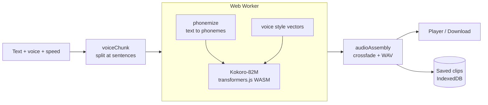

# Architecture

Voice Studio follows the suite convention: a thin **descriptor** owns the UI and
the storage wiring, and the expensive work — running an ONNX speech model — is a
self-contained engine that lives off the main thread. The app code is in
`extension/src/apps/voicestudio/`; the engine and its helpers are shared modules
under `extension/src/lib/`.

## Modules

| File                              | Role                                                                                                                                                                                                  |
| --------------------------------- | ----------------------------------------------------------------------------------------------------------------------------------------------------------------------------------------------------- |
| `apps/voicestudio/index.ts`       | The app descriptor — the voice bar and picker, the composer (text, speed, Speak/Cancel), the result card, the saved-clip sidebar, the settings schema, the agent tools, and the uninstall data hooks. |
| `components/appSettingsFields.ts` | The shared settings-schema renderer. Voice Studio declares `voice`, `speed` and `autosave`; this turns them into controls for both Settings ▸ Apps and the window's own settings dialog.              |
| `lib/engines/voiceCatalog.ts`     | The voice palette as data — the 28 English voices, their accent, gender and the model authors' own quality grade, plus grouping and lookup helpers. No DOM, no engine.                                |
| `lib/engines/voice.ts`            | The engine's main-thread half — owns one long-lived worker, correlates its messages by job id, stitches the returned chunks, and exposes synthesise / prefetch / dispose.                             |
| `lib/engines/voice.worker.ts`     | The worker — loads the model and tokenizer once, fetches a voice's style vectors, and synthesises one chunk of text at a time.                                                                        |
| `lib/engines/voicePhonemize.ts`   | The grapheme-to-phoneme frontend — normalises English text (numbers, currency, abbreviations, quotes) and converts it to the phoneme string the model's tokenizer wants.                              |
| `lib/voiceChunk.ts`               | Splitting long text into synthesis chunks at sentence boundaries. Pure and unit-tested.                                                                                                               |
| `lib/audioAssembly.ts`            | Crossfaded concatenation of the per-chunk audio, and WAV encoding. Pure and unit-tested.                                                                                                              |
| `lib/blobHistory.ts`              | The saved-clip history — records plus their audio blobs, with pruning and undo-friendly removal.                                                                                                      |
| `components/historySidebar.ts`    | The sidebar — clip list, per-row menu, select mode and bulk delete with undo.                                                                                                                         |
| `components/audioPlayer.ts`       | The playback control used for both a fresh render and a saved clip.                                                                                                                                   |
| `components/progressBar.ts`       | The normalised progress display, including the first-run download hint.                                                                                                                               |
| `lib/dataStore.ts`                | The local data store — clip records and their WAV blobs, in IndexedDB.                                                                                                                                |

## Data flow



## Why a worker

Synthesis is a loop of awaited model calls, one per chunk. On the main thread
that starves the event loop and freezes the whole new-tab page — the same defect
already measured and fixed for the Denoise and transcription engines. So it runs
in a Web Worker, and the main thread only stitches the audio the worker hands
back.

The worker is **long-lived**: the app keeps one alive for as long as it is open,
so the model and tokenizer are loaded once and previews and re-renders never
reload the weights. "Once" means once even under concurrent demand: the model load
caches its **in-flight promise**, so several voices requested together share one
load rather than each starting their own (`lib/asyncOnce.ts` → `sharedByKey`). The
fetches then run in parallel while the **inference is serialised** through a queue
from the same module — the WASM session is single-threaded, so overlapping runs buy
nothing, and a voice waiting its turn is reported as `Queued` rather than left
looking stalled. Closing the app terminates it, which frees the memory.
Per-chunk audio is **transferred** rather than copied across the worker boundary,
so a long narration does not duplicate megabytes of samples on every message.

A worker that dies — out of memory, a blocked WebAssembly load — rejects every
in-flight job rather than leaving callers waiting on promises that can never
settle.

## Chunking, and why it exists

The model truncates any single utterance past roughly 510 phoneme tokens, which
would silently drop the tail of a long paragraph. `voiceChunk.ts` therefore
splits the input first:

- **Sentences.** Text is broken at sentence terminators, but only where the next
  character looks like the start of a new sentence — so `"Stop!" she cried.`
  stays one sentence rather than two.
- **Packing.** Consecutive short sentences are packed together up to a
  conservative character budget, well under the token cap because a phoneme
  string runs longer than its source text. Fewer chunks means fewer model runs.
- **Over-long sentences.** A single sentence past the budget is split at clause
  punctuation first, then on whitespace, and only as a last resort inside a word
  longer than the budget itself.

No text is ever dropped: the chunks concatenated back together equal the input
with runs of whitespace collapsed. That property is asserted by unit tests.

## Stitching, and why it crossfades

Each chunk is its own utterance, so joining them with a plain copy leaves a
discontinuity at every seam — a faint but audible click, the classic failure of
naive concatenation. `audioAssembly.ts` instead **crossfades** each join over a
short equal-power ramp, using the near-silence that brackets every utterance, so
the click disappears without clipping speech. The result is encoded as mono
16-bit PCM in a WAV container at the model's native 24 kHz.

## Voices and where their bytes come from

A "voice" is not a separate model. Kokoro is a single set of weights plus a
per-speaker **style vector** file, `voices/<id>.bin`, that conditions it. The
worker fetches a voice file the first time that voice is used and keeps it for
the session.

Both the model files and the voice files come from the kimtos content host —
the same host every other on-device model in the suite is served from, resolved
from the shared configuration rather than written into the engine. There is no
third-party fallback: a model asset either comes from our host or fails loudly.
Everything is validated on arrival (a truncated response or an error page is
rejected, not cached as if it were audio data) and stored in the browser's cache,
which is what makes the app work offline afterwards.

The cached bytes are attributed to Voice Studio in the suite's storage console,
so the space they use is visible per-app and can be freed per-app.

## From letters to sounds, and why we wrote our own

This layer is deliberately built from permissively-licensed data. The obvious
off-the-shelf choice for this job is eSpeak-NG, which is what almost every Kokoro
integration uses — and it is **GPL-3.0-or-later**, so shipping a compiled copy of it
inside an MIT-licensed project is a copyleft conflict whatever the licence field of
the npm wrapper around it says. Voice Studio carries its own permissive path instead:

| Layer                     | Where it comes from                                                             | Licence      |
| ------------------------- | ------------------------------------------------------------------------------- | ------------ |
| Pronunciation dictionary  | The CMU Pronouncing Dictionary — 126,037 words, a 767 KB gzipped packaged asset | BSD-2-Clause |
| Phoneme alphabet mapping  | Written for KimtOS (`lib/g2p/arpabet.ts`)                                       | Ours         |
| Out-of-vocabulary words   | Letter-to-sound rules written for KimtOS (`lib/g2p/lts.ts`)                     | Ours         |
| Numbers, symbols, letters | Written for KimtOS (`lib/g2p/english.ts`)                                       | Ours         |

Both attributions are in `THIRD-PARTY-NOTICES.md`, as their licences require.

Every stage runs in the browser. That is not incidental — a server-side phonemiser is the
easy answer to this problem, and it was rejected outright because it would mean sending
the user's text off the device to decide how to say it.

Two details in the mapping are load-bearing and easy to get wrong:

- The voiced velar stop must be **U+0261 SCRIPT G**, not ASCII `g`. The model's tokenizer
  vocabulary has no ASCII `g`, so the wrong character deletes every hard g in the clip
  with no error anywhere.
- The stress mark goes immediately before the stressed **vowel**, not at the syllable
  boundary. The dictionary marks stress on vowels too, so the two line up and no
  syllabifier is needed.

British output is a transform of the same American dictionary: non-rhotic, with the GOAT,
TRAP and LOT vowels and the yod restored (`tune` is `tjuːn`), and no flapping. It cannot
carry a distinction the dictionary does not make — `bath` comes out with the TRAP vowel —
but neither does eSpeak's own British voice, which is what the model's British speakers
were trained on.

## Persistence

A saved clip is one record plus one blob:

```
{ id, name, at, audioKey, voice, text }   // record
audioKey -> the rendered WAV               // blob
```

Both live in the shared local database under the app's own partition, so they
appear under Voice Studio in the storage console and travel in a backup. The list
is capped at the most recent clips and older ones are pruned on save. Deleting a
clip removes its record and its audio blob together; uninstalling the app can
clear the whole collection and free the cached model.

**Voice samples are cached the same way.** The first time you play a voice's
sample it is synthesised like any other clip and then stored as a blob under
`voicestudio:preview/`, so the second play is a database read rather than a model
run — instant, and offline. The key carries a version segment, so changing the
sample line invalidates every stored sample rather than leaving stale audio
behind. Uninstalling clears these along with the saved clips.

**Settings do not live here.** `voice`, `speed` and `autosave` are declared on the
descriptor and persist in the sync store (`store.apps.voicestudio`), like every
other app's settings — the studio reads them on open, writes them when you pick a
voice or release the speed slider, and follows the store while it is open, so the
app and the settings dialog can never disagree.

## Agent tools

The descriptor declares four tools — `list_voices`, `speak_text`, `list_clips`
and `delete_clip` — routed through the same engine and the same storage the UI
uses, so they cannot drift from it. They are **dormant**: no on-device model
shipped today can reliably drive tool calls, so the agent loop is off and these
never execute. They are declared now so that switching the feature on later is a
runtime change rather than a rewrite.
